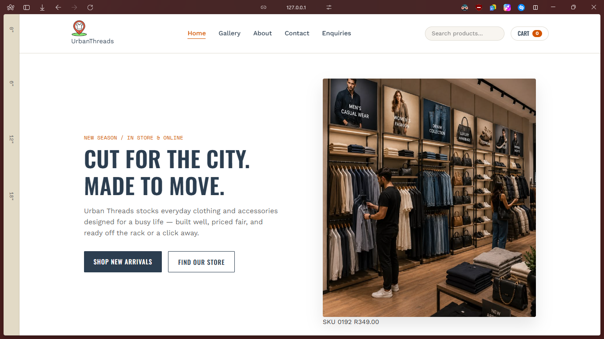
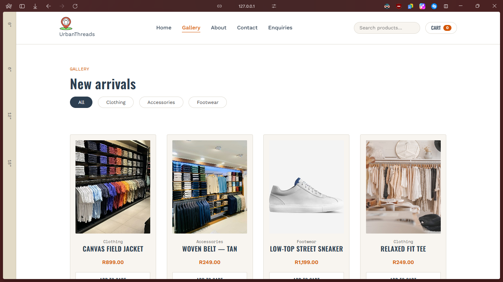
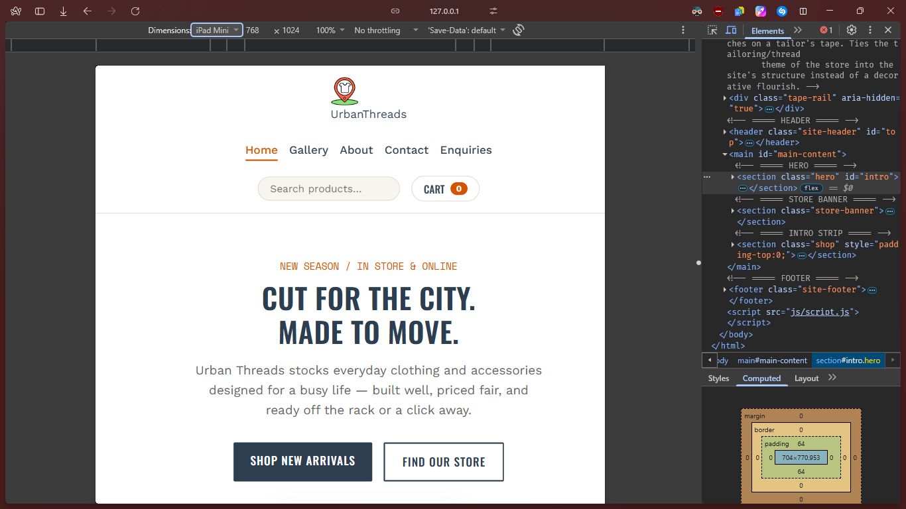
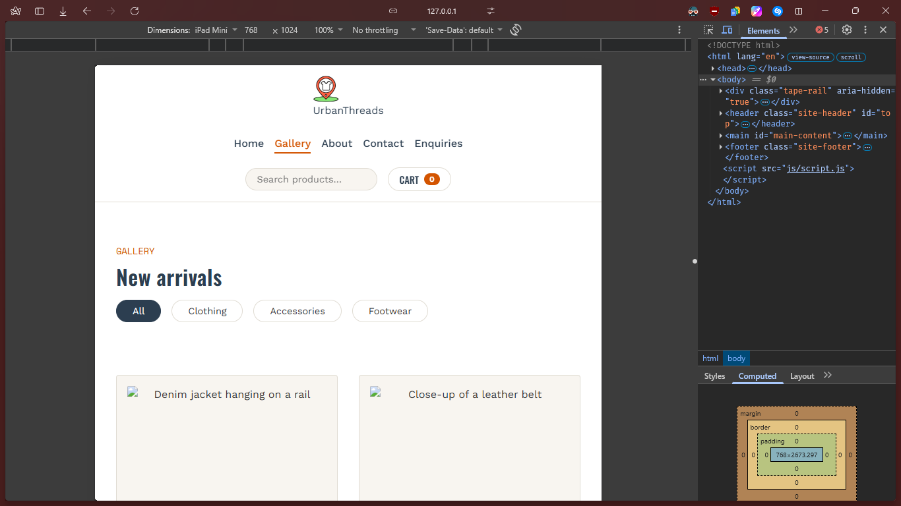

# Urban Threads — Web Development Portfolio

Urban Threads is a responsive front-end prototype for a local, family-run clothing and accessories store based in Pretoria, South Africa. This repository contains the HTML and CSS files developed for the WEDE5020 Portfolio of Evidence.

## Table of Contents
1. [Project Overview](#project-overview)
2. [Changelog (Part 1 Feedback & Part 2 Updates)](#changelog)
3. [Responsive Design Evidence](#responsive-design-evidence)
4. [Setup and Execution](#setup-and-execution)
5. [References](#references)

---

## 1. Project Overview
This project demonstrates semantic HTML structuring and modern CSS styling (Flexbox and Grid). The design focuses on a boutique e-commerce aesthetic, utilizing a custom color palette, responsive typography (`rem` and `em` units), and mobile-first media queries to ensure cross-device compatibility.

---

## 2. Changelog

### Part 1: Feedback Implementations
* **Documentation (Critical Fix):** Authored this comprehensive `README.md` file and integrated a structured Changelog, directly addressing the missing documentation penalty from the Part 1 submission.
* **Semantic HTML Validation:** Cleaned up page structures to ensure proper implementation of `<header>`, `<main>`, `<section>`, and `<footer>` tags across all five pages.
* **Asset Management:** Addressed missing media assets noted in Part 1 by inserting proper placeholder architectures (e.g., `<picture>` tags) for missing product images and mapping components.

### Part 2: Visual Styling and Responsive Design (Current Additions)
* **CSS Architecture:** Created an external `style.css` file and linked it across all HTML pages. Implemented a global CSS reset and defined custom CSS variables for the color palette and typography.
* **Layout Structures:**
  * Replaced default block layouts with **CSS Flexbox** for the primary navigation, hero sections, and form alignments.
  * Implemented **CSS Grid** for the product gallery, footer, and `about.html` layout to establish a clean, multi-column structure that dynamically adapts to screen widths.
* **Responsive Design:** Added mobile and tablet breakpoints (`@media (max-width: 900px)` and `@media (max-width: 768px)`) to collapse multi-column layouts into single columns for smaller screens. Removed the desktop-only decorative tape rail on mobile views.
* **Responsive Images:** Upgraded static `` tags in the gallery to `<picture>` elements utilizing `srcset` and `sizes` attributes for resolution switching based on viewport width.
* **Interactive Elements:** Added CSS pseudo-classes (`:hover`, `:focus`) to buttons, navigation links, and product cards for enhanced UI feedback.
* **Third-Party Integrations:** Embedded a live, interactive Google Map iframe into `contact.html` to replace the static HTML placeholder block.

### Part 3: Enhancing Functionality and SEO — 24 October 2026
The review against the supplied Part 3 brief found that several previously documented features were incomplete: submission was simulated using a timer, contact had no form, the FAQ accordion did not exist, product image paths failed on case-sensitive hosts, responsive image variants did not exist, and the sitemap referenced another site. These were corrected as follows.

- Added a native dialog lightbox with keyboard activation, Escape to close and automatic focus restoration, plus an FAQ accordion on the About page. Retained the interactive Google Map and added an accessible frame title.
- Added JavaScript catalogue loading from `data/products.json`, retaining HTML product cards as a fallback if loading fails. Added price/name sorting, combined search and category filters, and live result counts including a no-results message. Header search opens the gallery when Enter is pressed on other pages.
- Added distinct contact and product enquiry forms with names, email, optional phone, message topics and message length limits. Product enquiries include product and quantity choices and return an indicative total after successful submission, with stock and final price explicitly subject to confirmation.
- Replaced simulated submission with URL-encoded AJAX requests to Netlify Forms. Added field errors, accessible status messages, loading states and retry handling that keeps entries after failure. Native HTML validation and a thank-you page provide a no-JavaScript fallback. Newsletter signup also uses Netlify Forms. Enabled form detection for deployment and added spam honeypots.
- Prepared a contact email draft from validated input, addressed to the confirmed recipient, thanyanithabelo5@gmail.com. The visitor opens and sends the draft through their email app. Form submissions are collected separately by Netlify Forms; automatic email notifications are a separate Netlify dashboard setting and have not been configured.
- Repaired image filenames and generated real 400px, 800px and 1200px JPEG variants with compression. Added descriptive filenames and fixed hero alt text. Asset minification is not implemented and is no longer claimed.
- Added unique descriptions, canonical URLs and one primary heading per page. Updated the sitemap and robots file for the actual HTTPS deployment domain. Added local ClothingStore structured data matching the displayed Pretoria address and opening hours.
- Added response security headers, including a content security policy, clickjacking prevention, content-type protection and referrer restrictions. Used text content for catalogue and form messages. Added narrow-screen layout fixes and reduced-motion support.
- Replaced the fake checkout success message with a link to make a product enquiry. This remains a demonstration catalogue and has no payment integration. The existing cart is temporary and clears when navigating away.

### Part 3 assessment and evidence still required
The code fixes address the identified implementation gaps, but full assessment compliance cannot yet be certified. The user marked lecturer feedback from Part 2 as N/A, so no feedback-specific corrections are claimed. If feedback becomes available, record each actual feedback item and the correction made.

The brief also requires off-page SEO: actual backlinks, social promotion and local business presence. Those require real accounts, permission and external evidence; no links or campaign results have been fabricated. The existing social footer links were placeholders and now say profiles are coming soon. Replace these with verified store profiles when available.

The contact email recipient has been confirmed and configured. Deploy and verify each registered form in Netlify Forms, including receipt of genuine submissions. Submit the final repository link and deployed site URL to the LMS. Regular descriptive commits and pushing to the required remote remain submission workflow requirements; no repository history or submission completion has been claimed here.

### SEO keyword rationale
The selected terms are “Pretoria clothing boutique”, “local clothing and accessories”, “Urban Threads”, and product-specific names. They reflect the store location, offering and likely visitor intent and are incorporated naturally in page descriptions, headings, product text and internal links. No paid keyword-volume research has been performed.

### Validation and manual acceptance checklist
JavaScript syntax, local asset/link existence, form declarations, primary headings, unique descriptions, JSON catalogue and XML sitemap structure were checked without running a build. Browser interaction and live form receipt remain to be verified after deployment.

1. Open the gallery: confirm four products, search for “belt”, combine categories, test no results, and sort prices both directions. Block `data/products.json` and reload to check fallback cards.
2. Tab to a product image, press Enter, close the lightbox with Escape, and confirm focus returns to the trigger. Open and close each FAQ.
3. Submit empty forms and invalid email, phone, message and quantity values. Confirm errors and keyboard focus. Submit valid forms and confirm receipt in Netlify Forms; check Spam if a legitimate submission is missing.
4. Disconnect the network before submitting and confirm the form keeps entries and allows retry. Confirm successful enquiries show the correct indicative price total. Confirm the contact email draft contains the validated message and the confirmed recipient.
5. Test 360px, tablet and desktop layouts, image loading, keyboard focus and reduced motion. Existing screenshots predate these changes and are not evidence of this review.
6. Check `/robots.txt`, `/sitemap.xml`, canonical URLs, metadata and response security headers on the deployed site. Check the map and confirm business details with the store owner.
---

##  Responsive Design Evidence
*(Below are screenshots demonstrating the responsive behavior of the website across different device breakpoints, tested via Browser Developer Tools).*

### Desktop View (> 900px)
* 
* 

### Tablet View (768px - 900px)
* 
* 

### Mobile View (< 768px)
* 
* 

---

## 4. Setup and Execution
To run and test this project locally:
1. Clone the repository to your local machine using Git.
2. Open your terminal within the root project directory.
3. Start a local Python web server by executing: `python3 -m http.server 8000`
4. Navigate to `http://127.0.0.1:8000` in a modern web browser (e.g., Arc, Chrome, Edge).

---

## 5. References

**Technical Documentation**
* MDN Web Docs. 2026. *CSS Grid Layout*. Available at: https://developer.mozilla.org/en-US/docs/Web/CSS/CSS_Grid_Layout (Accessed: 18 September 2026).
* MDN Web Docs. 2026. *Responsive images*. Available at: https://developer.mozilla.org/en-US/docs/Learn/HTML/Multimedia_and_embedding/Responsive_images (Accessed: 18 September 2026).
* W3Schools. 2026. *CSS Flexbox*. Available at: https://www.w3schools.com/css/css3_flexbox.asp (Accessed: 18 September 2026).
* Google Maps Platform. 2026. *Embed a map*. Available at: https://developers.google.com/maps/documentation/embed/get-started (Accessed: 18 September 2026).

**Image Assets (Unsplash License)**
* Hero Tag (SKU 0192): Bernd Dittrich — unsplash.com/photos/94Tvp4AhlUU
* Denim Jacket: charlesdeluvio — unsplash.com/photos/8xTN-V_s6sU
* Woven Belt: seeetz — unsplash.com/photos/Mf194wsFKZI
* Polo Shirt: TuanAnh Blue — unsplash.com/photos/gYOQbqbs_mE
* Store Banner: Amanda Vick — unsplash.com/photos/zw_oaDbfzyE
* About Interior: Hugo Clément — unsplash.com/photos/JGtPrdnMgQc

