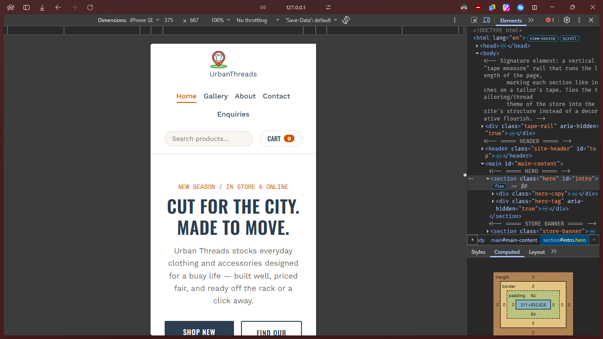
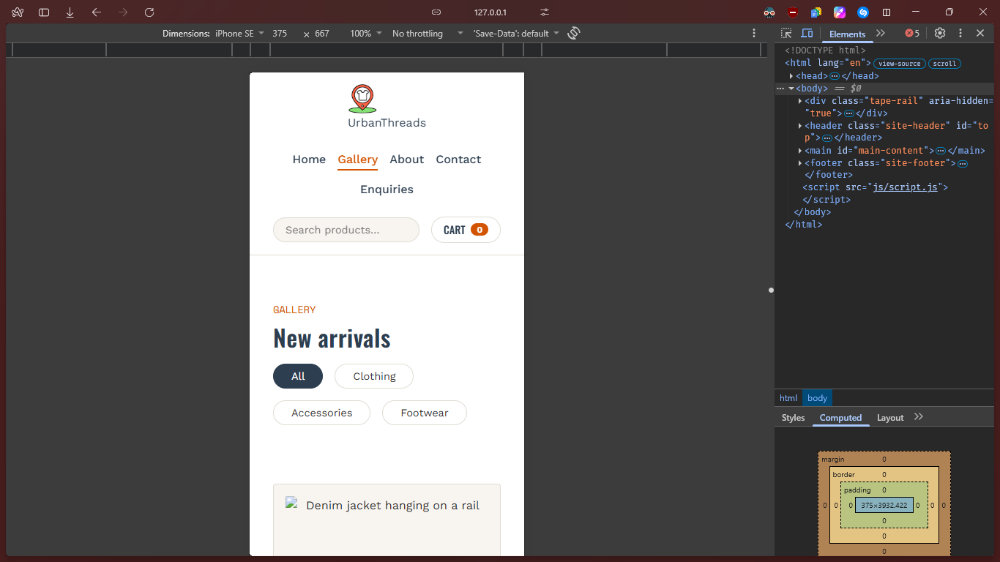

# Urban Threads — Web Development Portfolio

Urban Threads is a responsive front-end prototype for a local, family-run clothing and accessories store based in Pretoria, South Africa. This repository contains the HTML and CSS files developed for the WEDE5020 Portfolio of Evidence.

## Table of Contents
1. [Project Overview](#project-overview)
2. [Changelog (Part 1 Feedback & Part 2 Updates)](#changelog)
3. [Responsive Design Evidence](#responsive-design-evidence)
4. [Setup and Execution](#setup-and-execution)
5. [References](#references)

---

## 1. Project Overview
This project demonstrates semantic HTML structuring and modern CSS styling (Flexbox and Grid). The design focuses on a boutique e-commerce aesthetic, utilizing a custom color palette, responsive typography (`rem` and `em` units), and mobile-first media queries to ensure cross-device compatibility.

---

## 2. Changelog

### Part 1: Feedback Implementations
* **Documentation (Critical Fix):** Authored this comprehensive `README.md` file and integrated a structured Changelog, directly addressing the missing documentation penalty from the Part 1 submission.
* **Semantic HTML Validation:** Cleaned up page structures to ensure proper implementation of `<header>`, `<main>`, `<section>`, and `<footer>` tags across all five pages.
* **Asset Management:** Addressed missing media assets noted in Part 1 by inserting proper placeholder architectures (e.g., `<picture>` tags) for missing product images and mapping components.

### Part 2: Visual Styling and Responsive Design (Current Additions)
* **CSS Architecture:** Created an external `style.css` file and linked it across all HTML pages. Implemented a global CSS reset and defined custom CSS variables for the color palette and typography.
* **Layout Structures:**
  * Replaced default block layouts with **CSS Flexbox** for the primary navigation, hero sections, and form alignments.
  * Implemented **CSS Grid** for the product gallery, footer, and `about.html` layout to establish a clean, multi-column structure that dynamically adapts to screen widths.
* **Responsive Design:** Added mobile and tablet breakpoints (`@media (max-width: 900px)` and `@media (max-width: 768px)`) to collapse multi-column layouts into single columns for smaller screens. Removed the desktop-only decorative tape rail on mobile views.
* **Responsive Images:** Upgraded static `` tags in the gallery to `<picture>` elements utilizing `srcset` and `sizes` attributes for resolution switching based on viewport width.
* **Interactive Elements:** Added CSS pseudo-classes (`:hover`, `:focus`) to buttons, navigation links, and product cards for enhanced UI feedback.
* **Third-Party Integrations:** Embedded a live, interactive Google Map iframe into `contact.html` to replace the static HTML placeholder block.

---

## 3. Responsive Design Evidence
*(Below are screenshots demonstrating the responsive behavior of the website across different device breakpoints, tested via Browser Developer Tools).*

### Desktop View (> 900px)
* 
* 

### Tablet View (768px - 900px)
* 
* 

### Mobile View (< 768px)
* 
* 

---

## 4. Setup and Execution
To run and test this project locally:
1. Clone the repository to your local machine using Git.
2. Open your terminal within the root project directory.
3. Start a local Python web server by executing: `python3 -m http.server 8000`
4. Navigate to `http://127.0.0.1:8000` in a modern web browser (e.g., Arc, Chrome, Edge).

---

## 5. References

**Technical Documentation**
* MDN Web Docs. 2026. *CSS Grid Layout*. Available at: https://developer.mozilla.org/en-US/docs/Web/CSS/CSS_Grid_Layout (Accessed: 18 September 2026).
* MDN Web Docs. 2026. *Responsive images*. Available at: https://developer.mozilla.org/en-US/docs/Learn/HTML/Multimedia_and_embedding/Responsive_images (Accessed: 18 September 2026).
* W3Schools. 2026. *CSS Flexbox*. Available at: https://www.w3schools.com/css/css3_flexbox.asp (Accessed: 18 September 2026).
* Google Maps Platform. 2026. *Embed a map*. Available at: https://developers.google.com/maps/documentation/embed/get-started (Accessed: 18 September 2026).

**Image Assets (Unsplash License)**
* Hero Tag (SKU 0192): Bernd Dittrich — unsplash.com/photos/94Tvp4AhlUU
* Denim Jacket: charlesdeluvio — unsplash.com/photos/8xTN-V_s6sU
* Woven Belt: seeetz — unsplash.com/photos/Mf194wsFKZI
* Polo Shirt: TuanAnh Blue — unsplash.com/photos/gYOQbqbs_mE
* Store Banner: Amanda Vick — unsplash.com/photos/zw_oaDbfzyE
* About Interior: Hugo Clément — unsplash.com/photos/JGtPrdnMgQc
